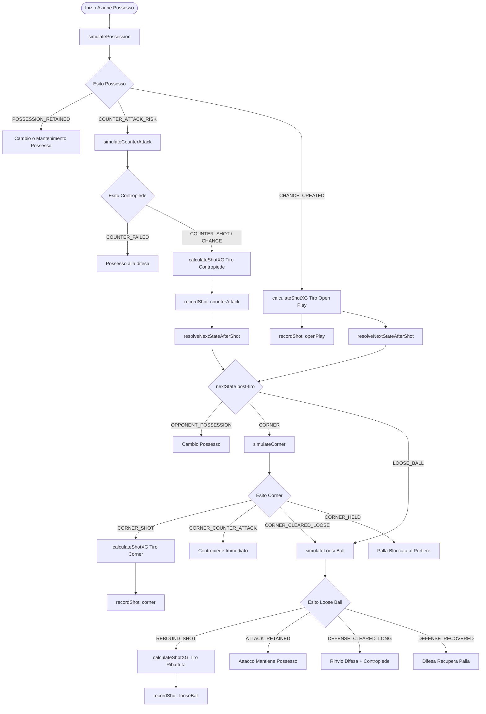

# Architettura del Motore di Simulazione: `simulateSequence`

Questo documento descrive dettagliatamente il funzionamento del metodo `simulateSequence` di `SimGameService` e di tutti i servizi e funzioni correlati all'interno della simulazione della partita di calcio (`calcio_sim`).

---

## Indice

1. [Panoramica e Flusso Decisionale](#1-panoramica-e-flusso-decisionale)
2. [Orchestrazione Principale](#2-orchestrazione-principale)
   - [`simulateSequence`](#simulatesequence)
   - [`runHalfTime`](#runhalftime)
3. [Funzioni del Motore di Gioco (`SimGameService`)](#3-funzioni-del-motore-di-gioco-simgameservice)
   - [`resolveNextStateAfterShot`](#resolvenextstateaftershot)
   - [`resolveLooseBall`](#resolvelooseball)
   - [`recordShot`](#recordshot)
   - [`finalizeTeamStats`](#finalizeteamstats)
4. [Funzioni di Calcolo Azioni (`SimAzioneService`)](#4-funzioni-di-calcolo-azioni-simazioneservice)
   - [`simulatePossession`](#simulatepossession)
   - [`calculatePassMultiplier`](#calculatepassmultiplier)
   - [`calculateCompletionProbability`](#calculatecompletionprobability)
   - [`calculateGeneratedXG`](#calculategeneratedxg)
   - [`simulateCounterAttack`](#simulatecounterattack)
   - [`calculateShotXG`](#calculateshotxg)
   - [`simulateCorner`](#simulatecorner)
   - [`simulateLooseBall`](#simulatelooseball)
5. [Dinamica del Playmaking e Statistiche Squadra (`TeamStats`)](#5-dinamica-del-playmaking-e-statistiche-squadra-teamstats)
6. [Matrice di Aggiornamento delle Statistiche](#6-matrice-di-aggiornamento-delle-statistiche)

---

## 1. Panoramica e Flusso Decisionale

Il motore simula una sequenza di gioco discreta strutturata su due tempi regolamentari. Ogni tempo è composto da $N$ macro-azioni. All'interno di ciascuna macro-azione il possesso palla evolve attraverso una macchina a stati finiti probabilistica:



---

## 2. Orchestrazione Principale

### `simulateSequence`
- **File**: `src/app/services/sim-game.service.ts`
- **Firma**: `public simulateSequence(input: GameSequenceInput, N: number): GameSequenceResult`
- **Ruolo**: Entrypoint della simulazione completa. Esegue i due tempi e aggrega i dati.

#### Input:
- `input: GameSequenceInput`:
  - `teamA: TeamStats`: Statistiche effettive della squadra A.
  - `playstyleA: PlaystyleConfig`: Tattica della squadra A (`verticality`, `defensiveLine` in scala $[0.0, 1.0]$).
  - `teamB: TeamStats`: Statistiche effettive della squadra B.
  - `playstyleB: PlaystyleConfig`: Tattica della squadra B.
  - `startingPossession: 'A' | 'B'`: Squadra che inizia la partita.
- `N: number`: Numero di macro-azioni per tempo (es. $20$).

#### Algoritmo:
1. Inizializza i contatori globali di sequenza (`counterAttacksCount`, `cornersCount`, `looseBallsCount`).
2. Crea le strutture dati vuote `statsA` e `statsB` tramite `createEmptyTeamStats()`.
3. Esegue il **1° Tempo**: chiama `runHalfTime` con palla iniziale a `'A'`.
4. Esegue il **2° Tempo**: chiama `runHalfTime` con palla iniziale a `'B'` (inversione possesso).
5. Chiama `finalizeTeamStats(statsA, statsB)` per calcolare medie, percentuali di possesso e arrotondamenti decimali.
6. Restituisce `GameSequenceResult`.

#### Output:
- `totalActions`: $N \times 2$ (configurato da `SIMULATESEQUENCE_HALFTIME_DIVISOR`).
- `sequenceDetails`: `{ counterAttacksCount, cornersCount, looseBallsCount }`.
- `statsA`: Statistiche consolidate Squadra A.
- `statsB`: Statistiche consolidate Squadra B.

---

### `runHalfTime`
- **File**: `src/app/services/sim-game.service.ts`
- **Firma**: `private runHalfTime(N, startingTeam, input, statsA, statsB, onCorner, onLooseBall, onCounter): void`
- **Ruolo**: Simula un singolo tempo di gioco eseguendo un ciclo di $N$ iterazioni.

#### Variabili di Stato Locali:
- `currentPossession: 'A' | 'B'`: Squadra attualmente in possesso della palla.
- `currentPassSequence: number`: Conteggio consecutivo di passaggi completati dalla squadra attualmente in possesso. Si resetta a $0$ quando la palla cambia proprietario tramite `switchPossession()`.

#### Helper Interni:
- `addPasses(team, count, state)`:
  - Incrementa `stats.passesByState[state] += count`
  - Incrementa `stats.passesByState.total += count`
  - Incrementa `currentPassSequence += count`
  - Aggiorna il record `stats.passesByState.maxPassSequence` se `currentPassSequence` supera il massimo precedente.
- `switchPossession(newPossession)`:
  - Se `currentPossession !== newPossession`, cambia il possesso e resetta `currentPassSequence = 0`.

#### Algoritmo di Selezione per Iterazione ($i = 0 \dots N-1$):
1. Determina `attackingTeam = currentPossession` e `defendingTeam` opposto.
2. Invoca `simAzioneService.simulatePossession(...)` passando `currentPassSequence`.
3. Registra i passaggi completati dell'azione manovrata: `addPasses(attackingTeam, passesCompleted, 'openPlay')`.
4. **Valuta l'esito (`possessionResult.outcome`)**:
   - **Caso `CHANCE_CREATED`**:
     1. Chiama `simAzioneService.calculateShotXG(...)` con `baseXG = possessionResult.generatedBaseXG`.
     2. Registra il tiro: `recordShot(currentStatsAtt, shotResult, 'openPlay')`.
     3. Risolve gli sviluppi successivi al tiro: `nextPossession = resolveNextStateAfterShot(shotResult.nextState, ...)`.
     4. `switchPossession(nextPossession)`.
   - **Caso `COUNTER_ATTACK_RISK`**:
     1. Incrementa `onCounter()`.
     2. Cambia possesso alla difesa: `switchPossession(defendingTeam)`.
     3. Invoca `simAzioneService.simulateCounterAttack(...)`.
     4. Registra i passaggi del contropiede: `addPasses(defendingTeam, counterPasses, 'counterAttack')`.
     5. Se il contropiede genera tiro (`COUNTER_SHOT` o `COUNTER_CHANCE_CREATED`):
        - Chiama `simAzioneService.calculateShotXG(...)`.
        - Registra il tiro: `recordShot(currentStatsDef, shotResult, 'counterAttack')`.
        - Risolve gli sviluppi successivi: `nextPossession = resolveNextStateAfterShot(shotResult.nextState, defendingTeam, attackingTeam, ...)`.
        - `switchPossession(nextPossession)`.
     6. Altrimenti (contropiede fallito senza tiro), il possesso rimane alla squadra che ha difeso: `switchPossession(defendingTeam)`.
   - **Caso `POSSESSION_RETAINED`**:
     1. `switchPossession(possessionResult.currentPossession ?? defendingTeam)`.

---

## 3. Funzioni del Motore di Gioco (`SimGameService`)

### `resolveNextStateAfterShot`
- **Firma**: `private resolveNextStateAfterShot(nextState, attackingTeam, defendingTeam, sourceState, input, statsA, statsB, onCorner, onLooseBall, onCounter, addPasses): 'A' | 'B'`
- **Ruolo**: Dirige il gioco in base alla traiettoria o respinta del tiro (`nextState`).

#### Logica:
1. **Se `nextState === 'CORNER'`**:
   - Notifica `onCorner()` e incrementa `currentStatsAtt.cornersWon++`.
   - Chiama `simAzioneService.simulateCorner(...)`.
   - Aggiunge i passaggi del corner all'attacco: `addPasses(attackingTeam, 2, 'corner')`.
   - In base a `cornerResult.outcome`:
     - `'CORNER_SHOT'`: Esegue `calculateShotXG`, registra il tiro con `recordShot(..., 'corner')` e restituisce `defendingTeam`.
     - `'CORNER_COUNTER_ATTACK'`: Notifica `onCounter()` e restituisce `defendingTeam`.
     - `'CORNER_CLEARED_LOOSE'`: Rimanda a `resolveLooseBall(...)`.
     - Default: Restituisce `defendingTeam`.
2. **Se `nextState === 'LOOSE_BALL'`**:
   - Rimanda a `resolveLooseBall(...)`.
3. **Default (`OPPONENT_POSSESSION`)**:
   - Palla al portiere o ripartenza difensiva: restituisce `defendingTeam`.

---

### `resolveLooseBall`
- **Firma**: `private resolveLooseBall(attackingTeam, defendingTeam, input, statsA, statsB, onLooseBall, onCounter, addPasses): 'A' | 'B'`
- **Ruolo**: Risolve contese su palloni vaganti / seconde palle / respinte.

#### Logica:
1. Notifica `onLooseBall()`.
2. Chiama `simAzioneService.simulateLooseBall(...)`.
3. In base a `looseResult.outcome`:
   - `'REBOUND_SHOT'`:
     - `currentStatsAtt.looseBallsWon++`
     - `addPasses(attackingTeam, 2, 'looseBall')`
     - Calcola tiro con `calculateShotXG` (con `baseXG = 0.20`)
     - `recordShot(currentStatsAtt, reboundShotResult, 'looseBall')`
     - Restituisce `defendingTeam`.
   - `'ATTACK_RETAINED'`:
     - `currentStatsAtt.looseBallsWon++`
     - `addPasses(attackingTeam, 2, 'looseBall')`
     - Restituisce `attackingTeam` (l'attacco insiste).
   - `'DEFENSE_CLEARED_LONG'`:
     - `currentStatsDef.looseBallsWon++`
     - `addPasses(defendingTeam, 2, 'looseBall')`
     - Notifica `onCounter()`
     - Restituisce `defendingTeam`.
   - `'DEFENSE_RECOVERED'`:
     - `currentStatsDef.looseBallsWon++`
     - `addPasses(defendingTeam, 2, 'looseBall')`
     - Restituisce `defendingTeam`.

---

### `recordShot`
- **Firma**: `private recordShot(stats: TeamSequenceStats, shotResult: any, state: 'openPlay' | 'counterAttack' | 'corner' | 'looseBall'): void`
- **Ruolo**: Aggiorna i contatori tiri, gol ed xG per lo stato specifico.

#### Logica di Aggiornamento:
```typescript
stats.shots.total++;
stats.xgByState[state] += shotResult.finalXG;
stats.totalXG += shotResult.finalXG;

if (shotResult.outcome === 'GOAL') {
  stats.goals++;
  stats.shots.onTarget++;
} else if (['SAVED_HELD', 'SAVED_CORNER', 'SAVED_REBOUND'].includes(shotResult.outcome)) {
  stats.shots.onTarget++;
} else if (shotResult.outcome === 'BLOCKED') {
  stats.shots.blocked++;
} else if (shotResult.outcome === 'POST_BAR_REBOUND') {
  stats.shots.woodwork++;
}
```

---

### `finalizeTeamStats`
- **Firma**: `private finalizeTeamStats(statsA: TeamSequenceStats, statsB: TeamSequenceStats): void`
- **Ruolo**: Normalizza i numeri a fine partita calcolando xG per tiro e percentuale di possesso.

#### Formule:
- **xG Arrotondati**: Arrotondati a 2 cifre decimali via `.toFixed(2)` per `openPlay`, `counterAttack`, `corner`, `looseBall` e `totalXG`.
- **xG per Tiro**:
  $$\text{xgPerShot} = \begin{cases} \dfrac{\text{totalXG}}{\text{shots.total}} & \text{se } \text{shots.total} > 0 \\ 0 & \text{altrimenti} \end{cases}$$
- **Percentuale Possesso Palla**:
  Calcolata sul totale dei passaggi completati da entrambe le squadre:
  $$\text{possessionSharePercent}_A = \dfrac{\text{passesTotal}_A}{\text{passesTotal}_A + \text{passesTotal}_B} \times 100$$
  (se il totale passaggi è $0$, il fallback predefinito è $50.0\%$).

---

## 4. Funzioni di Calcolo Azioni (`SimAzioneService`)

Tutte le funzioni analitiche e statistiche risiedono in `SimAzioneService` (`src/app/services/sim-azione.service.ts`).

---

### `simulatePossession`
- **Firma**: `public simulatePossession(input: SimulationInput): ActionSimulationResult`
- **Input**:
  - `attackingTeam`, `defendingTeam`: Istanze `TeamStats`.
  - `attackingPlaystyle`: `{ verticality: v, defensiveLine: d }`.
  - `defendingPlaystyle`: `{ verticality: v_def, defensiveLine: d_def }`.
  - `currentPassSequence`: Numero passaggi attivi nella catena di possesso.
- **Formule**:
  1. **Passaggi Base Tentati**:
     $$\text{basePasses} = \text{BASE\_PASSES\_MAX} - v \times \text{PASSES\_VERTICALITY\_WEIGHT} = 8 - (v \times 4)$$
  2. **Passaggi Effettivi Completati**:
     $$\text{passesCompleted} = \text{basePasses} \times \text{calculatePassMultiplier}(att, def, \text{currentPassSequence})$$
  3. **Probabilità di Completamento**:
     $$P_{\text{completion}} = \text{calculateCompletionProbability}(att, def, v, d, \text{currentPassSequence})$$
  4. **Tiro Dado 1 (`roll` $\in [0, 1)$)**:
     - Se $\text{roll} > P_{\text{completion}}$: **Palla Persa $\to$ `COUNTER_ATTACK_RISK`**.
       - Calcolo Rischio Contropiede:
         $$v_{\text{risk}} = v + (v - 0.5)^2 \times 1.5$$
         $$\text{counterRisk} = \text{clamp}\left((v_{\text{risk}} \times 0.11 + d \times 0.15 + d_{\text{def}} \times 0.65) \times 1.0, \; 0, \; 1\right)$$
       - `highRecovery = true` se $d_{\text{def}} > 0.60$.
     - Altrimenti: **Passaggio Completato**.
  5. **Tiro Dado 2 per Sfondamento (`secondRoll` $\in [0, 1)$)**:
     - Calcolo probabilità di creare un'occasione:
       $$\text{spaceToExploit} = (d_{\text{def}} - 0.5) \times 0.35$$
       $$\text{supportFromBehind} = (d - 0.5) \times 0.10$$
       $$P_{\text{breakthrough}} = \text{clamp}(0.18 + v \times 0.35 + \text{spaceToExploit} + \text{supportFromBehind}, \; 0.10, \; 0.85)$$
     - Se $\text{secondRoll} < P_{\text{breakthrough}}$: **`CHANCE_CREATED`**.
       - Calcola $xG = \text{calculateGeneratedXG}(att, def, v, d, \text{currentPassSequence})$.
     - Altrimenti: **`POSSESSION_RETAINED`** (la squadra fa girare palla senza tirare).

---

### `calculatePassMultiplier`
- **Firma**: `private calculatePassMultiplier(att: TeamStats, def: TeamStats, currentPassSequence: number): number`
- **Ruolo**: Calcola il moltiplicatore sul volume dei passaggi usando una curva logaritmica sul rapporto di forza tra regia d'attacco e pressione difensiva.
- **Formule**:
  1. $\text{buildUp} = \text{att.midfield} \times 0.5 + \text{att.getPlaymaking(currentPassSequence)} \times 0.5$
  2. $\text{pressure} = \text{def.pressing} \times 0.5 + \text{def.defense} \times 0.5$
  3. $\text{controlRatio} = \dfrac{\text{buildUp}}{\max(1, \text{pressure})}$
  4. $\text{logMultiplier} = 1.0 + 0.8 \times \ln(\text{controlRatio})$
  5. Ritorna $\text{clamp}(\text{logMultiplier}, 0.2, 2.5)$.

---

### `calculateCompletionProbability`
- **Firma**: `private calculateCompletionProbability(att, def, v, d, currentPassSequence): number`
- **Ruolo**: Calcola la precisione nel completamento della manovra.
- **Formule**:
  1. $\text{buildUpQuality} = \text{att.getPlaymaking(currentPassSequence)} \times 0.6 + \text{att.midfield} \times 0.4$
  2. $\text{defensivePressure} = \text{def.pressing} \times 0.6 + \text{def.defense} \times 0.4$
  3. $\text{baseProb} = 0.70 + \dfrac{\text{buildUpQuality} - \text{defensivePressure}}{100}$
  4. $\text{verticalityPenalty} = 0.075 + (v - 0.5) \times 0.35$
  5. $P = \text{baseProb} - \text{verticalityPenalty} + d \times 0.05$
  6. Ritorna $\text{clamp}(P, 0.30, 0.95)$.

---

### `calculateGeneratedXG`
- **Firma**: `private calculateGeneratedXG(att, def, v, d, currentPassSequence): number`
- **Ruolo**: Determina la qualità della palla gol costruita su azione manovrata.
- **Formule**:
  1. $\text{attQual} = \text{att.attack} \times 0.6 + \text{att.getPlaymaking(currentPassSequence)} \times 0.4$
  2. $\text{defQual} = \text{def.defense} \times 0.7 + \text{def.pressing} \times 0.3$
  3. $\text{defensiveLineFactor} = 0.75 + d \times 0.5$
  4. $\text{rawXG} = 0.16 \times \left(\dfrac{\text{attQual}}{\max(1, \text{defQual})}\right) \times \text{defensiveLineFactor}$
  5. Ritorna $\text{clamp}(\text{rawXG}, 0.03, 0.50)$.

---

### `simulateCounterAttack`
- **Firma**: `public simulateCounterAttack(input: CounterAttackInput): CounterAttackResult`
- **Input**:
  - `attackingTeam`, `defendingTeam`: Istanze `TeamStats`.
  - `counterAttackRisk`: Rischio calcolato dalla palla persa precedente (default $0.5$).
  - `defendingPlaystyle`: Tattica della squadra che subisce il contropiede.
- **Formule**:
  1. $\text{risk} = \text{clamp}(\text{validRisk} \times 1.1, \; 0.1, \; 1.0)$
  2. $\text{passesCompleted} = \lfloor \text{clamp}(2 + \text{risk} \times 2, \; 1, \; 4) \rfloor$
  3. $P_{\text{breakthrough}} = 0.30 + \text{risk} \times 0.25 + d_{\text{defender}} \times 0.1$
  4. **Tiro Dado (`roll` $\in [0, 1)$)**:
     - Se $\text{roll} < P_{\text{breakthrough}}$: **`COUNTER_SHOT`**.
       - $\text{lineMultiplier} = 0.85 + d_{\text{defender}} \times 0.25$
       - $\text{generatedXG} = 0.16 \times (0.65 + \text{risk} \times 0.35) \times \text{lineMultiplier}$
     - Altrimenti: **`COUNTER_FAILED`**.

---

### `calculateShotXG`
- **Firma**: `public calculateShotXG(input: ShotXGInput): ExtendedShotXGResult`
- **Input**:
  - `baseXG`: xG base dell'opportunità generata.
  - `attacker`: Statistica attacco normalizzata ($\text{stat} / 100$).
  - `defender`: Statistica difensiva normalizzata ($\text{stat} / 100$).
  - `goalkeeper`: Statistica portiere normalizzata ($\text{stat} / 100$).
- **Formule**:
  1. **Modificatori Statistiche**:
     $$\text{attackerBonus} = 0.53 + (\text{attacker} - 0.5) \times 0.2$$
     $$\text{defenderPenalty} = 1.51 - (\text{defender} - 0.5) \times 0.2$$
  2. **xG Finale**:
     $$\text{finalXG} = \text{clamp}(\text{baseXG} \times \text{attackerBonus} \times \text{defenderPenalty}, \; 0.01, \; 0.95)$$
  3. **Risoluzione Gol (`roll` $\in [0, 1)$)**:
     - Se $\text{roll} < \text{finalXG}$: **`GOAL`**, `nextState: 'OPPONENT_POSSESSION'`.
  4. **Risoluzione Esiti Non-Gol (`outcomeRoll` $\in [0, 1)$)**:
     Vengono confrontate le soglie cumulative da `SIM_CONFIG.SHOT_OUTCOMES`:
     - $< 0.35$: **`BLOCKED`** $\to$ `nextState: 'LOOSE_BALL'`
     - $< 0.58$: **`SAVED_CORNER`** $\to$ `nextState: 'CORNER'`
     - $< 0.74$: **`SAVED_REBOUND`** $\to$ `nextState: 'LOOSE_BALL'`
     - $< 0.76$: **`SAVED_HELD`** $\to$ `nextState: 'OPPONENT_POSSESSION'`
     - $< 0.82$: **`POST_BAR_REBOUND`** $\to$ `nextState: 'LOOSE_BALL'`
     - $\ge 0.82$: **`OUT`** (fuori) $\to$ `nextState: 'OPPONENT_POSSESSION'`

---

### `simulateCorner`
- **Firma**: `public simulateCorner(input: CornerInput): CornerResult`
- **Input**:
  - `attackerAerial`: Peso aereo dell'attacco ($0.4 \times \text{attack} + 0.6 \times \text{cornerAttack}$).
  - `defenderAerial`: Peso aereo della difesa ($0.4 \times \text{defense} + 0.6 \times \text{cornerDefense}$).
- **Formule**:
  1. $\text{advantage} = \text{attackerAerial} - \text{defenderAerial}$
  2. Tiro dado contro soglie:
     - $< 0.30 + \text{advantage} \times 0.20 \to$ **`CORNER_SHOT`** (`generatedBaseXG = 0.28`, `nextState: 'SHOT'`)
     - $< 0.70 \to$ **`CORNER_CLEARED_LOOSE`** (`nextState: 'LOOSE_BALL'`)
     - $< 0.85 \to$ **`CORNER_COUNTER_ATTACK`** (`nextState: 'COUNTER_ATTACK'`)
     - Altrimenti $\to$ **`CORNER_HELD`** (`nextState: 'OPPONENT_POSSESSION'`)

---

### `simulateLooseBall`
- **Firma**: `public simulateLooseBall(input: LooseBallInput): LooseBallResult`
- **Input**:
  - `attackerReactivity`: $0.5 \times \text{pressing} + 0.5 \times \text{attack}$
  - `defenderReactivity`: $0.6 \times \text{defense} + 0.4 \times \text{pressing}$
- **Formule**:
  1. $\text{advantage} = \text{attackerReactivity} - \text{defenderReactivity}$
  2. Tiro dado contro soglie:
     - $< 0.20 + \text{advantage} \times 0.15 \to$ **`REBOUND_SHOT`** (`generatedBaseXG = 0.20`, `nextState: 'SHOT'`)
     - $< 0.50 + \text{advantage} \times 0.20 \to$ **`ATTACK_RETAINED`** (`nextState: 'POSSESSION_RETAINED'`)
     - $< 0.75 \to$ **`DEFENSE_CLEARED_LONG`** (`nextState: 'COUNTER_ATTACK'`)
     - Altrimenti $\to$ **`DEFENSE_RECOVERED`** (`nextState: 'OPPONENT_POSSESSION'`)

---

## 5. Dinamica del Playmaking e Statistiche Squadra (`TeamStats`)

Le statistiche base fornite alle squadre subiscono una trasformazione mediante la classe `TeamStats`:

### Moltiplicatori di Ruolo
Ogni statistica ha un moltiplicatore configurato in `SIM_CONFIG.STAT_MULTIPLIERS`:
- `midfield`: $1.35$
- `playmaking`: $0.75$ (moltiplicatore base)
- `attack`: $1.24$
- `defense`: $0.55$
- `pressing`: $0.60$
- `goalkeeper`: $1.0$
- `cornerAttack`: $1.0$
- `cornerDefense`: $1.0$

### Scala Dinamica della Regia (`getPlaymaking`)
A differenza delle altre statistiche che dispongono di getter statici, il valore di **Playmaking** scala in base alla lunghezza della sequenza di passaggi ininterrotta (`currentPasses`):

$$\text{effectivePlaymaking} = \text{clamp}(\text{basePlaymaking} \times 0.75 \times M_{\text{scheme}}, \; 0, \; 100)$$

Dove $M_{\text{scheme}}$ è ricavato dallo schema di passaggi `passThresholds`:

| Passaggi Consecutivi Raggiunti | Moltiplicatore $M_{\text{scheme}}$ |
| :---: | :---: |
| $\ge 25$ | $1.25$ |
| $\ge 21$ | $1.20$ |
| $\ge 18$ | $1.16$ |
| $\ge 15$ | $1.12$ |
| $\ge 12$ | $1.08$ |
| $\ge 9$ | $1.05$ |
| $\ge 6$ | $1.03$ |
| $\ge 3$ | $1.01$ |
| $\ge 0$ | $1.00$ |

Più una squadra fa circolare palla senza perderla, più aumenta la sua efficacia di manovra e la qualità degli xG generati.

---

## 6. Matrice di Aggiornamento delle Statistiche

La seguente tabella riepiloga come i vari eventi modificano l'oggetto `TeamSequenceStats`:

| Evento / Esito | `goals` | `shots.total` | `shots.onTarget` | `shots.blocked` | `shots.woodwork` | `xgByState` & `totalXG` | `passesByState` | `cornersWon` | `looseBallsWon` | `maxPassSequence` |
| :--- | :---: | :---: | :---: | :---: | :---: | :---: | :---: | :---: | :---: | :---: |
| **Passaggi Open Play** | - | - | - | - | - | - | `+passesCompleted` (openPlay & total) | - | - | Aggiornato se $>$ max |
| **Tiro Open Play: Gol** | `+1` | `+1` | `+1` | - | - | `+finalXG` (openPlay) | - | - | - | - |
| **Tiro Open Play: Parata** | - | `+1` | `+1` | - | - | `+finalXG` (openPlay) | - | - | - | - |
| **Tiro Open Play: Murato** | - | `+1` | - | `+1` | - | `+finalXG` (openPlay) | - | - | - | - |
| **Tiro Open Play: Palo/Traversa** | - | `+1` | - | - | `+1` | `+finalXG` (openPlay) | - | - | - | - |
| **Tiro Open Play: Fuori** | - | `+1` | - | - | - | `+finalXG` (openPlay) | - | - | - | - |
| **Passaggi Contropiede** | - | - | - | - | - | - | `+counterPasses` (counterAttack & total) | - | - | Aggiornato se $>$ max |
| **Tiro da Contropiede** | Se Gol `+1` | `+1` | Se Porta `+1` | Se Murato `+1` | Se Legno `+1` | `+finalXG` (counterAttack) | - | - | - | - |
| **Calcio d'Angolo Assegnato** | - | - | - | - | - | - | `+2` (corner & total) | `+1` | - | Aggiornato se $>$ max |
| **Tiro da Corner** | Se Gol `+1` | `+1` | Se Porta `+1` | Se Murato `+1` | Se Legno `+1` | `+finalXG` (corner) | - | - | - | - |
| **Seconda Palla Vinta** | - | - | - | - | - | - | `+2` (looseBall & total) | - | `+1` | Aggiornato se $>$ max |
| **Tiro su Ribattuta (Rebound)** | Se Gol `+1` | `+1` | Se Porta `+1` | Se Murato `+1` | Se Legno `+1` | `+finalXG` (looseBall) | - | - | - | - |
